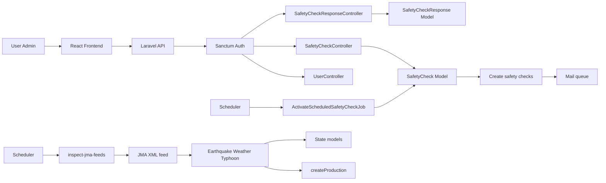
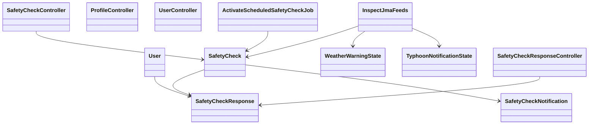

# Reactの安否確認  

  
  


  


  


## プロジェクト概要
このリポジトリは、バックエンドに Laravel、フロントエンドに React + TypeScript + Vite を持つ SPA 型の安否確認アプリケーションです。

## 学習・検証目的
- CRUD + API通信の理解
- SPAでの認証についての理解
- バックエンドを中心とした開発において、フロントエンドとの連携に必要な知識・実装の理解
- React / TypeScriptからLaravel APIを利用する一連の流れの検証

## 主な機能
- CRUD + API通信
  - 安否確認の作成、管理、通知
  - 送信: キューとスケジューラを利用した定時処理
  - プロフィール変更
  - `AdminController` にて 管理者向けユーザー管理 API（一覧・作成・更新・削除）
- 認証フロー
  - ユーザー認証（Fortify）
  - API 認証（Sanctum ミドルウェア適用）
  - 権限管理: Spatie Permission
- フロントエンド骨格（React + TypeScript + Vite + Tailwind）
- 管理者チェック用ミドルウェア
  - ユーザー一覧取得
  - ユーザー追加
  - ユーザー更新
  - ユーザー削除
- 一般ユーザー
  - 安否確認の回答
- 災害情報連携: 気象庁 XML フィードの解析
  - 地震情報
  - 気象警報・注意報
  - 台風に関する情報
  - 台風の確率情報

## 使用技術
| カテゴリ | 使用技術 |
| :--- | :--- |
| **Backend** | Laravel 13 |
| **Frontend** | React `^19.2.7`, Tailwind CSS, Node.js |
| **Authentication / Authorization** | Fortify, Spatie Laravel Permission 8.3 |
| **Infrastructure** | Docker Compose (App / Node / MySQL / Nginx) |
| **OS Environment** | WSL2 (Ubuntu / Alpine Linux) |
| **Database** | MySQL 8.x |

## セットアップ手順

### 1. インフラのビルドと起動
```
docker compose build
docker compose up -d
```

### 2. バックエンド初期化
```
docker compose exec app ash
composer create-project laravel/laravel .
chown -R www-data:www-data storage bootstrap/cache
chmod -R 775 storage bootstrap/cache
```
#### 3. 認証・認可packcageの導入
```
composer require laravel/sanctum
php artisan install:api
composer require laravel/fortify
php artisan fortify:install
composer require spatie/laravel-permission
php artisan vendor:publish --provider="Spatie\Permission\PermissionServiceProvider"
```
### 4. フロントエンド初期化
```
docker compose run --rm node sh
npm create vite@latest . -- --template react-ts
npm install
npm install tailwindcss @tailwindcss/vite
npm install @iconify/react
```
#### 5. .env修正・作成  
※ バックエンドはcompose.ymlに設定した内容に修正。
※ フロントエンドは作成する。
```
VITE_API_URL=http://localhost:8000/api
```
#### 6. マイグレーション
```
php artisan migrate
```
#### 7. その他(バックエンド)
```
composer require --dev "squizlabs/php_codesniffer=*"
composer require --dev barryvdh/laravel-debugbar
composer require laravel-lang/lang:~8.0
php artisan lang:publish
cp ./vendor/laravel-lang/lang/json/ja.json ./lang/
cp -r ./vendor/laravel-lang/lang/src/ja ./lang/
```

#### 8. その他(フロントエンド)
```
docker compose exec node sh
npm install axios
npm list axios
npm list react-router-dom
```

#### 9. 認証の設定(バックエンド)
※下記で、`config/core.php`
```
php artisan config:publish cors
```
```
    'allowed_origins' => ['http://localhost:5173'],
    'supports_credentials' => true,
```

#### 10. メール設定(gmailの場合)  
- セキュリティで2段階認証をonにする  
- .env下記内容を修正
```
MAIL_MAILER=smtp
MAIL_SCHEME=null
MAIL_HOST=smtp.gmail.com
MAIL_PORT=465
MAIL_USERNAME=受信先のメールアドレス
MAIL_PASSWORD=アプリパスワード
MAIL_ENCRYPTION=ssl
MAIL_FROM_ADDRESS="送信元のメールアドレス"
```

## ディレクトリ構成（主要部分）
```text
- compose.yaml
- README.md
- backend/
  - artisan
  - composer.json
  - package.json
  - .env.example
  - phpunit.xml
  - vite.config.js
  - app/
    - Actions/
      - Fortify/
        - CreateNewUser.php
        - PasswordValidationRules.php
        - ResetUserPassword.php
        - UpdateUserPassword.php
        - UpdateUserProfileInformation.php
    - Console/
      - Commands/
        - InspectJmaFeeds.php
    - Http/
      - Controllers/
        - Controller.php
        - ProfileController.php
        - SafetyCheckController.php
        - SafetyCheckResponseController.php
        - UserController.php
      - Requests/
        - StoreSafetyCheckRequest.php
        - StoreSafetyCheckResponseRequest.php
        - StoreUserRequest.php
        - UpdateProfileRequest.php
        - UpdateSafetyCheckRequest.php
        - UpdateUserRequest.php
    - Jobs/
      - ActivateScheduledSafetyCheckJob.php
    - Mail/
      - SafetyCheckNotification.php
    - Models/
      - SafetyCheck.php
      - SafetyCheckResponse.php
      - TyphoonNotificationState.php
      - User.php
      - WeatherWarningState.php
    - Providers/
      - AppServiceProvider.php
      - FortifyServiceProvider.php
  - bootstrap/
  - config/
  - database/
    - factories/
    - migrations/
    - seeders/
  - lang/
  - public/
  - resources/
    - css/
    - js/
    - views/
      - emails/
      - welcome.blade.php
  - routes/
    - api.php
    - console.php
    - web.php
  - storage/
  - tests/
- frontend/
  - README.md
  - package.json
  - public/
    - favicon.svg
    - icons.svg
  - src/
    - App.tsx
    - Register.tsx
    - index.css
    - login.tsx
    - main.tsx
    - api/
    - assets/
    - components/
      - layout/
        - AuthenticatedLayout.tsx
    - pages/
      - Admin/
        - Dashboard/
        - SafetyCheck/
        - User/
      - Auth/
      - Home/
      - Profile/
    - routes/
    - safety-checks/
      - ResponsePage.tsx
      - api/
      - components/
- nginx/
  - default.conf
- php/
  - Dockerfile
- mysql/
```
## 設計・実装の特徴設計・実装の特徴
- Laravel を中心に API とジョブ処理を構築
  - `backend/routes/api.php`
- React + TypeScript で SPA を実装
- 管理者権限と一般ユーザーの認可を明確に分離
  - `User`
  - `HasRoles`
  - `HasApiTokens`
- 気象庁 XML から災害情報を取り込み、安否確認へ変換
  - `app:inspect-jma-feeds`
  - `SafetyCheckController`
  - `createProduction()`
- キューとスケジューラで通知処理を非同期化
  - `ActivateScheduledSafetyCheckJob`
  - `SafetyCheckNotification`

以下の3点を重視
- API と SPA の分離による明確な責務分離
- 管理者と一般ユーザーの認証・認可を安全に扱うこと
- 災害情報の取得と安否確認の起票を自動化すること

---

## 処理の流れ



## クラス構成図


## 今後の改善予定
- 台風：進路・予報情報の解析処理はある一方、台風確率情報の本番通知・状態更新は未実装。
- 台風のどの情報を警戒対象にするか、通知条件・状態管理・重複通知をどうするか整理する。